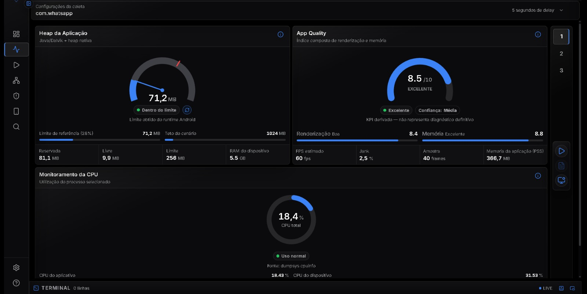
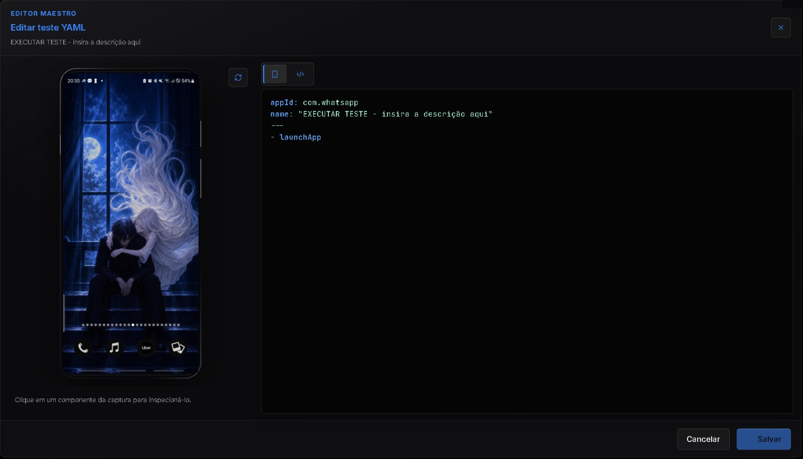
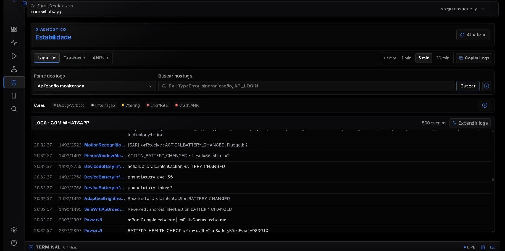
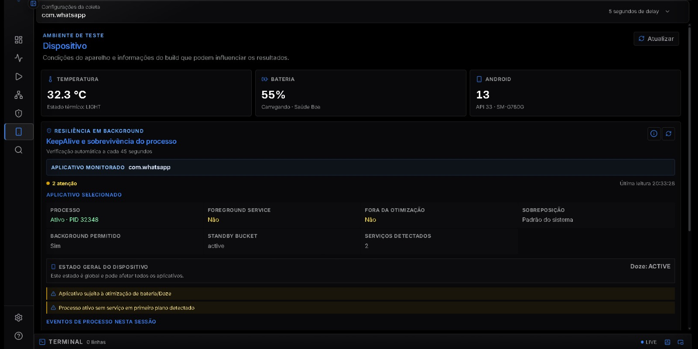
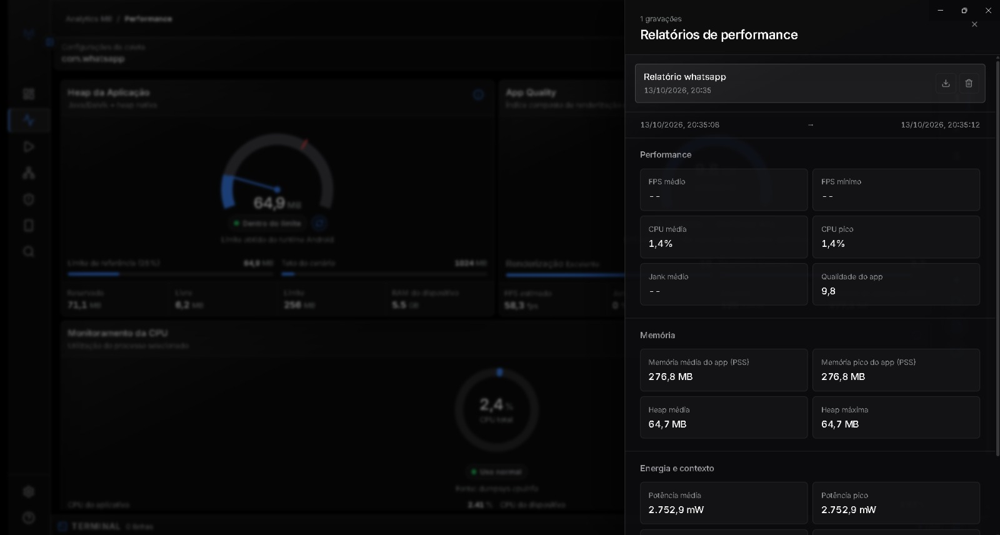

# AnalyticsMB

**Diagnóstico de performance Android, automação de QA e evidências técnicas em um só workspace.**

[](RELEASE.md)
[](https://github.com/Erikvilar/analyticsmb-project/releases/tag/beta-release-v22.1.20265)
[](docs/DISTRIBUTION.md)
[](docs/ARCHITECTURE.md)
[](LICENSE)

AnalyticsMB é uma aplicação desktop para investigar o comportamento de aplicativos Android. Ela reúne coleta via ADB, métricas em tempo real, diagnóstico de estabilidade, testes Maestro e gravações exportáveis em PDF, sem exigir um SDK no aplicativo para as métricas fundamentais.

Este é o repositório público de demonstração e documentação do produto desenvolvido no repositório principal AnalyticsMB. Aqui você encontra capturas da aplicação, evolução funcional, decisões de engenharia e exemplos de código; a implementação completa permanece privada.

> **Maestro reproduz o comportamento. AnalyticsMB mede o impacto.**



*Performance em uma sessão demonstrativa: heap, qualidade de renderização, memória e CPU com contexto de amostragem. Os valores da captura pertencem àquela sessão e não constituem um benchmark do WhatsApp.*

[Veja a aplicação](#a-aplicação-em-uso) · [Melhorias recentes](#melhorias-recentes) · [Como experimentar](#como-experimentar) · [Documentação](#documentação)

## Da investigação à evidência

Investigar performance Android costuma exigir alternar entre `adb`, `dumpsys`, `gfxinfo`, `meminfo`, `logcat`, Maestro e scrcpy. O AnalyticsMB aproxima essas ferramentas em um fluxo de trabalho: selecionar o dispositivo e o aplicativo, observar os sinais, reproduzir um cenário e registrar uma janela de medição para análise.

O produto atende desenvolvedores Android, React Native e .NET MAUI, profissionais de QA e equipes que investigam regressões, crashes, ANRs e processos interrompidos em segundo plano.

| Área | O que você pode investigar |
| --- | --- |
| Performance | CPU da aplicação e do dispositivo, memória PSS, heap, FPS estimado, jank e indicadores de qualidade com contexto da amostra. |
| Estabilidade | Logs, crashes e ANRs com busca, seleção de fonte, filtros temporais e severidades visuais. |
| Dispositivo | Bateria, temperatura, versão do Android e condições de execução que ajudam a interpretar os resultados. |
| Resiliência | Estado do processo, serviços, permissões de background, otimização de bateria, standby e Doze. |
| Testes Maestro | Importação de flows e subflows, edição YAML, inspeção visual, cenários salvos, execução e telemetria associada ao teste. |
| Gravações e relatórios | Início e fim explícitos da coleta, histórico das gravações, resumo de indicadores e exportação em PDF. |
| Ferramentas de diagnóstico | Rede, exploração de bancos mobile em builds compatíveis, terminal integrado e espelhamento com scrcpy. |

## Melhorias recentes

A versão publicada mais recente é **[22.4.20265](https://github.com/Erikvilar/analyticsmb-project/releases/tag/beta-release-v22.1.20265)**, disponibilizada em **13 de outubro de 2026**, no arquivo **`AnalyticsMB.7z`**. O link mantém a tag original da publicação, `beta-release-v22.1.20265`, embora seu título identifique a versão `22.4.20265`. Consulte [RELEASE.md](RELEASE.md) para download e SHA-256.

As melhorias abaixo foram verificadas no código e na documentação do repositório principal, cuja versão interna consultada é **`22.4.2026`**. Esse identificador é distinto do título da release pública.

- **Interface Black Glass e layout responsivo.** Tema escuro com superfícies, tipografia e controles consistentes entre as telas. Tokens globais ajustam densidade, navegação e cards à área disponível; os selects receberam cores explícitas, foco visível e contraste no tema escuro.
- **Telemetria em tempo real com qualidade de amostragem.** CPU, memória/heap, qualidade, FPS e estabilidade contam com fluxos de atualização. A coleta de frames considera a janela observada e a taxa de atualização da tela; ausência de dados e amostras insuficientes não devem aparecer como um zero válido.
- **Editor Maestro com UI Inspector.** A edição YAML passou a conviver com a captura da tela e a inspeção da hierarquia de elementos. Flows e subflows são validados, cenários preservam snapshots e a execução acompanha logs e métricas até a finalização.
- **Gravações de performance independentes dos widgets.** Ao iniciar uma gravação, a coleta mantém o pacote selecionado e uma janela explícita de início e fim, mesmo com navegação entre páginas. O histórico reúne os resultados daquela gravação e permite exportar seu PDF.
- **PDFs com mais contexto técnico.** Os relatórios de gravação incluem séries de heap e FPS, comparação entre CPU da aplicação e do dispositivo, indicadores agregados, unidades, glossário e indicação de dados indisponíveis.
- **Exploração de bancos mais utilizável.** O explorador recebeu otimizações de apresentação e colunas redimensionáveis para facilitar a leitura de tabelas e resultados de consultas.
- **Continuidade da conexão ADB.** Coletores, Maestro e scrcpy compartilham o daemon associado ao dispositivo. A recuperação do UI Automator limpa a captura e o processo auxiliar sem solicitar `reconnect`, `kill-server` ou `start-server`.

Os relatórios acessíveis pela interface são contextuais às gravações e aos testes. A infraestrutura de análise histórica não significa que exista hoje uma tela geral de comparação entre quaisquer versões, pacotes ou períodos.

## A aplicação em uso

As capturas abaixo foram fornecidas para esta demonstração em 13 de outubro de 2026. Elas mostram o AnalyticsMB com `com.whatsapp` selecionado, além de informações do dispositivo e logs visíveis naquela sessão. O WhatsApp é apenas o aplicativo usado no exemplo, sem vínculo com o projeto.

### Editar um teste com a tela do dispositivo ao lado

O editor reúne YAML e captura do Android na mesma área de trabalho. O UI Inspector permite inspecionar os elementos da captura para apoiar a construção dos comandos. Neste exemplo, o flow configura `com.whatsapp` e a ação `launchApp`; a captura ainda mostra a tela inicial do dispositivo.



### Investigar logs, crashes e ANRs

A tela de Estabilidade organiza a investigação por fonte, busca e janela de tempo. A legenda de severidades facilita a leitura, e o visor pode ser expandido. A captura mostra a janela de cinco minutos e os eventos disponíveis no momento da leitura.



### Entender o ambiente e a sobrevivência do processo

Temperatura, bateria e versão do Android contextualizam a medição. O monitor de resiliência reúne estado do processo, serviços em primeiro plano, otimização de bateria e Doze, ajudando a investigar restrições de execução em background.



### Consultar uma gravação de performance

O painel de relatórios apresenta o intervalo gravado e os indicadores de performance, memória e energia disponíveis. A captura mostra uma gravação curta: campos sem amostra aparecem como `--`, preservando a diferença entre ausência de informação e valor zero. A exportação PDF está disponível na ação do relatório.



O [catálogo de screenshots](docs/screenshots/README.md) descreve os arquivos e o contexto de cada captura.

## Como funciona

```text
Interface React + TypeScript
            ↓
         API local
            ↓
    Serviços de domínio
       ↙            ↘
ADB / Maestro / scrcpy   Repositories → SQLite
       ↓
Comandos → Parsers → Métricas e eventos
```

Controllers tratam HTTP, serviços coordenam as operações, repositories cuidam da persistência e parsers transformam a saída das ferramentas. Menus, widgets e outras famílias extensíveis usam contratos e registries. Isso permite evoluir as funcionalidades sem concentrar novas regras em um único componente ou serviço.

A coleta e a persistência analítica são locais. Autenticação e conteúdo de idiomas dependem de serviços remotos; **local-first não significa operação totalmente offline**. A interface usa Tolgee, com idiomas declarados em catálogo central e conteúdo publicado remotamente.

Leia a [arquitetura pública](docs/ARCHITECTURE.md), as [decisões de engenharia](docs/ENGINEERING_DECISIONS.md) e as [definições das métricas](docs/OBSERVABILITY.md).

## Como experimentar

### Usar a aplicação distribuída

1. Use Windows 10 ou 11 x64 e um Android com depuração USB ativada.
2. Conecte o dispositivo por USB e autorize o computador no Android.
3. Mantenha conexão com a internet para autenticação e conteúdo de idiomas.
4. Baixe [AnalyticsMB.7z — versão 22.4.20265](https://github.com/Erikvilar/analyticsmb-project/releases/download/beta-release-v22.1.20265/AnalyticsMB.7z).
5. Confira o SHA-256 em [RELEASE.md](RELEASE.md), extraia o pacote completo e siga as instruções de instalação incluídas.

O ZIP de código-fonte deste showcase não é o instalador. Consulte [RELEASE.md](RELEASE.md) para a identificação da distribuição documentada e [distribuição](docs/DISTRIBUTION.md) para os requisitos de instalação.

### Explorar os exemplos de engenharia

```bash
yarn install
yarn build
yarn test
yarn showcase:check
```

O conteúdo de [`showcase/`](showcase/) demonstra contratos tipados, parser, calculator, testes, componentes, hooks, registries e temas. Esses exemplos usam dados sintéticos e não iniciam a aplicação completa. A verificação `showcase:check` examina caminhos e conteúdo textual; a revisão das imagens é visual.

## Status e limites de interpretação

O AnalyticsMB está em **Beta**. A disponibilidade de métricas varia conforme versão do Android, fabricante, permissões e estado do aplicativo. A exploração de dados privados pode exigir um build depurável. O App Quality é um indicador composto, não um diagnóstico definitivo, e correlação temporal entre eventos não comprova causalidade.

As capturas demonstram recursos da interface, não garantem resultados para qualquer dispositivo. Builds beta sem assinatura comercial também podem acionar o SmartScreen. Consulte [limitações](docs/LIMITATIONS.md), [histórico público](CHANGELOG.md) e [roadmap](ROADMAP.md).

## Documentação

| Documento | Conteúdo |
| --- | --- |
| [Arquitetura](docs/ARCHITECTURE.md) | Componentes, fluxo de dados e responsabilidades. |
| [Decisões de engenharia](docs/ENGINEERING_DECISIONS.md) | Contexto, escolhas e trade-offs. |
| [Observabilidade](docs/OBSERVABILITY.md) | Definição e validade das métricas. |
| [Modelo de segurança](docs/SECURITY_MODEL.md) | Fronteiras de confiança e minimização de dados. |
| [Distribuição](docs/DISTRIBUTION.md) | Runtime Windows e verificação de integridade. |
| [Evolução do produto](docs/PRODUCT_EVOLUTION.md) | Trajetória do workspace e das capacidades de diagnóstico. |
| [Screenshots](docs/screenshots/README.md) | Galeria, contexto e nomes dos arquivos. |

## Escopo público e contribuição

Este repositório publica documentação, exemplos arquiteturais com dados sintéticos e capturas demonstrativas da aplicação. As imagens podem exibir o identificador de um aplicativo público, métricas e trechos de diagnóstico da sessão; não representam dados sintéticos dos exemplos de código.

Orquestração ADB completa, engine Maestro, repositories e migrations de produção, engine de relatórios, runtime do terminal, autenticação, launcher e instalador permanecem no repositório principal privado.

Para bugs, propostas e documentação, consulte [SUPPORT.md](SUPPORT.md) e [CONTRIBUTING.md](CONTRIBUTING.md). Vulnerabilidades devem seguir o canal descrito em [SECURITY.md](SECURITY.md).

## Licença

O showcase é disponibilizado para avaliação técnica e portfólio. Ele **não concede licença open source nem permissão de redistribuição**. Consulte [LICENSE](LICENSE).
